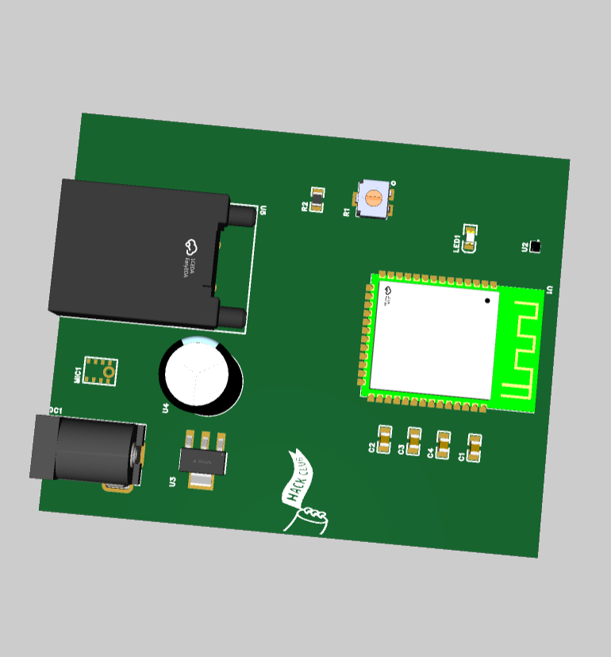
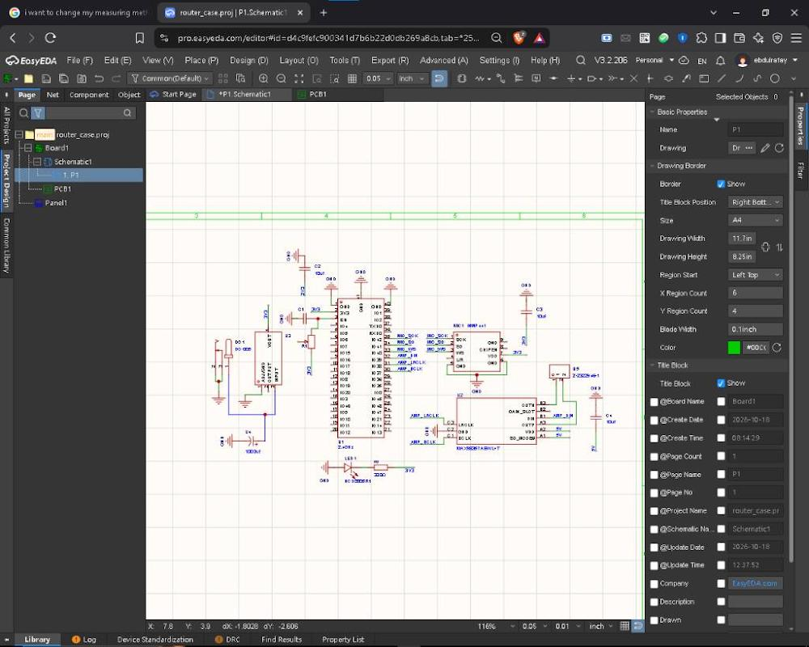

# Local AI Voice Assistant Node

A custom, fully self-hosted AI voice assistant built into a repurposed Wi-Fi router enclosure. This project operates entirely within a local network, giving you a private smart speaker experience without relying on cloud services, data tracking, or paid subscriptions.

## Overview

Most smart speakers send your audio data to cloud servers for processing. This node runs locally by capturing audio on an embedded PCB, streaming it over Wi-Fi to a local server running Ollama and n8n, and playing back the AI response—all within your home network.

The custom PCB is designed in EasyEDA to fit precisely inside a **6.2 x 7.2 cm** Mercusys router housing.

## Hardware Architecture

| Component | Description |
| --- | --- |
| **Microcontroller** | ESP32-S3 (Wi-Fi streaming & I2S audio processing) |
| **Audio Input** | INMP441 I2S digital omnidirectional microphone module |
| **Audio Output** | MAX98357A I2S Class-D mono amplifier |
| **Power Management** | DC barrel jack (9V/12V input) with a mini step-down buck converter to 5V rail |
| **Enclosure** | Repurposed Wi-Fi router casing (6.2 x 7.2 cm PCB footprint) |

## System Architecture & Flow

```
[ INMP441 Mic ] ---> (I2S) ---> [ ESP32-S3 ] ---> (Local Wi-Fi) ---> [ Local Server ]
                                                                             |
                                                                     (Ollama + n8n)
                                                                             |
[ 5W Speaker ] <--- (Audio) <--- [ MAX98357A ] <--- (I2S) <--- [ ESP32-S3 ] <---
```

1. **Audio Capture:** The INMP441 records digital audio via I2S and feeds it to the ESP32-S3.
2. **Local Processing:** The ESP32-S3 streams the audio buffer over local Wi-Fi to a host server running Ollama (LLM) and n8n (workflow orchestration).
3. **Response Synthesis:** The server processes the request, generates a response, and converts it to speech.
4. **Playback:** The synthesized audio stream is received by the ESP32-S3 and sent to the MAX98357A amplifier for speaker output.

## Enclosure & Form Factor

The PCB layout is specifically constrained to fit inside the router housing while reusing its original DC barrel power jack location.

| Case Exterior | Case Interior |
| :---: | :---: |
|  |  |

## 3D PCB layout

The schematic and 3D PCB layout were designed in EasyEDA with proper power rail distribution (9V/12V input down to 5V and 3.3V) and isolated digital audio connections.

<p align="center">
  
</p>

## Schematics
<p align="center">
  
</p>

## PCB Layout
<p align="center">
  
</p>

## Project Setup & Usage

### Hardware Prerequisites

* Custom PCB (fabricated or breadboard prototype)
* ESP32-S3 Development Module
* INMP441 I2S Microphone
* MAX98357A I2S DAC/Amp Module
* Step-Down Buck Converter (9V/12V to 5V)
* 4-8 Ohm Speaker
* Local server running Docker with Ollama and n8n

## Software & Firmware Setup

> **Note:** The core firmware implementation, I2S audio driver configuration, and local server integration (Ollama + n8n) are currently on hold. Full firmware flashing, hardware testing, and software debugging will commence as soon as the fabricated PCB and physical hardware components arrive.

### Planned Software Architecture:
1. **ESP32-S3 Firmware:**
   - I2S digital audio sampling (INMP441) and audio output streaming (MAX98357A).
   - Wi-Fi connection management and raw audio payload transmission over HTTP/WebSocket.
2. **Local Host Server:**
   - **Ollama:** Self-hosted local LLM instance processing incoming user voice prompts.
   - **n8n Automation:** Workflow orchestration to route audio streams, trigger local processing, and return synthesized speech back to the node.
## License

This project is open-source under the MIT License.
